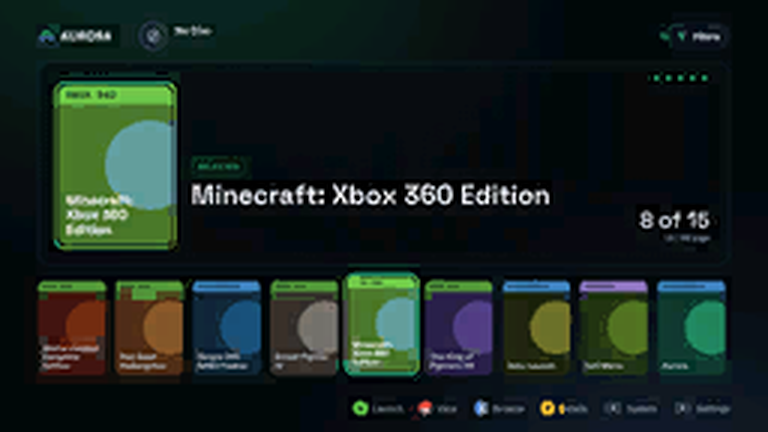

# Polar Glass — Aurora Skin

> Near-black ground, glass panels, one bright accent.

A clean, dark skin for the **Aurora** dashboard on modded Xbox 360 consoles, with a matching **Polar Glass** CoverFlow layout.



| | |
|---|---|
| **Skin name** | Polar Glass |
| **Revision** | 1 |
| **Built for** | Aurora 0.7b |
| **Files** | `PolarGlass.xzp` (skin) · `Polar Glass.cfljson` (CoverFlow layout) |

## Features

- Near-black background with soft green/blue aurora glow
- Frosted "glass" panels with a single bright green accent
- Typography in **IBM Plex Sans / Plex Mono** and **Space Grotesk**
- Re-styled main view, game details, settings, file manager, utilities and dialogs
- Companion CoverFlow layout: a single row of 13 covers with a large featured cover

## Download

Grab the latest zip from the [**Releases**](../../releases/latest) page. Avoid **Code → Download ZIP**, which includes the repo extras you don't need.

## Installation

The release zip mirrors Aurora's own folder structure:

```
Aurora/
├── Skins/
│   └── PolarGlass.xzp
└── Media/
    └── Layouts/
        └── Polar Glass.cfljson
```

1. **Copy the files to your console.** Extract the zip and copy the `Aurora` folder over your Aurora install folder (for example `Hdd1:\Apps\Aurora\`), merging folders when asked. You can use FTP (FileZilla, etc.) or a USB drive with Aurora's file manager.
   - Skin → `Aurora\Skins\PolarGlass.xzp`
   - Layout → `Aurora\Media\Layouts\Polar Glass.cfljson`
2. **Apply the skin.** In Aurora, open **Settings → Appearance → Skin**, select **Polar Glass**, and restart Aurora if it asks.
3. **Apply the CoverFlow layout.** Press **B** → **View → Theme**, choose the **Polar Glass** CoverFlow layout, and press **A**.

> The skin is designed to be used **together with** the Polar Glass CoverFlow layout. Other layouts will work, but covers may overlap the panels.

### Uninstall

Switch back to another skin in Aurora's settings, then delete `PolarGlass.xzp` and `Polar Glass.cfljson`.

## Compatibility

| Aurora version | Status |
|---|---|
| 0.7b | ✅ Supported |
| 0.6b and older | ❌ Not supported (skin format differs) |

## Troubleshooting

- **Skin doesn't appear in the list:** make sure the file ends in `.xzp` and sits directly in `Aurora\Skins\`, not in a subfolder.
- **Layout doesn't appear:** make sure the `.cfljson` is in `Aurora\Media\Layouts\`, then restart Aurora.
- **Covers look misplaced:** select the Polar Glass CoverFlow layout (see step 3).
- **Anything else:** [open an issue](../../issues) with your Aurora version and a photo or screenshot.

## Credits

- **Aurora** dashboard by the Phoenix team. Aurora, Phoenix and related logos belong to their respective owners. This skin is an unofficial, fan-made project.
- **IBM Plex** fonts © IBM Corp., and **Space Grotesk** © The Space Grotesk Project Authors, both used under the [SIL Open Font License 1.1](licenses/OFL.txt). See [THIRD_PARTY_NOTICES.md](THIRD_PARTY_NOTICES.md).

## License

The original artwork and layout in this repo are licensed under [CC BY-NC-SA 4.0](LICENSE). You may share and remix them for non-commercial use, with credit, under the same license. Bundled fonts remain under the SIL OFL 1.1.

---

*Use at your own risk. This project is for modded consoles running homebrew software and is not affiliated with or endorsed by Microsoft.*
